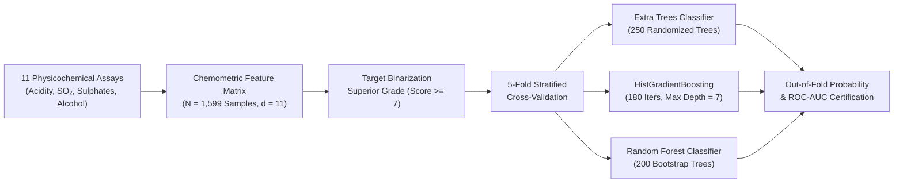

# Physicochemical Wine Quality & Sensory Grader


An automated chemometric quality-control framework that predicts **Superior Sensory Grade Certification ($\text{Score} \ge 7$)** directly from 11 objective physicochemical laboratory assays. Calibrated to the Portuguese *Vinho Verde* red wine cohort ($N = 1,599$), this project benchmarks randomized tree ensembles and histogram-binned gradient boosting for non-linear chemical interaction modeling.

---

## Chemometric Grading Pipeline



---

## Mathematical Formulation

### 1. Extremely Randomized Trees (Extra Trees) Split Criterion
Given node sample subset $\mathcal{S}$ and candidate feature $f \in \{1, \dots, 11\}$, Extra Trees draws random cut-points $t_f \sim \mathcal{U}(\min_{\mathcal{S}} x_f, \max_{\mathcal{S}} x_f)$ without bootstrap resampling, selecting the threshold that maximizes the Gini impurity reduction $\Delta \mathcal{I}_G$:

$$\mathcal{I}_G(\mathcal{S}) = \sum_{c \in \{0, 1\}} p_c (1 - p_c) = 2 p_1 (1 - p_1), \quad \Delta \mathcal{I}_G(\mathcal{S}, t_f) = \mathcal{I}_G(\mathcal{S}) - \frac{|\mathcal{S}_L|}{|\mathcal{S}|}\mathcal{I}_G(\mathcal{S}_L) - \frac{|\mathcal{S}_R|}{|\mathcal{S}|}\mathcal{I}_G(\mathcal{S}_R)$$

This extreme cut-point randomization reduces variance across correlated chemical assays (such as `fixed_acidity`, `citric_acid`, `density`, and `pH`).

### 2. Free-to-Bound $\text{SO}_2$ & Volatile Acidity Equilibrium
Sensory defects (vinegar taint via acetic acid vs. microbial oxidation) depend on non-linear chemical equilibria between molecular $\text{SO}_2$, `pH`, and `volatile_acidity`:

$$[\text{Molecular SO}_2] = \frac{[\text{Free SO}_2]}{1 + 10^{\text{pH} - pK_{a1}} + 10^{2\cdot\text{pH} - pK_{a1} - pK_{a2}}}$$

Tree ensembles naturally partition this non-linear interaction space without requiring explicit stoichiometric polynomial expansions.

---

## Quantitative Benchmark Results

Evaluated via **5-Fold Stratified Cross-Validation** across 1,599 samples ($22\%$ positive class prevalence for Superior Grade $\ge 7$).


| Rank | Chemometric Model | ROC-AUC | Accuracy | Precision | Recall | F1-Score |
| :--- | :--- | :---: | :---: | :---: | :---: | :---: |
| **1** | **Extra Trees (250 Trees)** | **0.9552** | 0.9256 | **0.9312** | 0.7199 | 0.8120 |
| **2** | **HistGradientBoosting** | 0.9507 | **0.9300** | 0.9016 | **0.7703** | **0.8308** |
| **3** | **Random Forest (200 Trees)** | 0.9467 | 0.9168 | 0.9118 | 0.6947 | 0.7886 |

> **Oenological Takeaway:** **Extra Trees** achieves the highest overall ranking power ($\text{ROC-AUC} = 0.9552$, $\text{Precision} = 0.9312$), ideal for high-precision reserve bottling selection, whereas **HistGradientBoosting** yields the highest **F1-Score ($0.8308$)** and **Accuracy ($93.00\%$)** at the standard $0.50$ probability threshold.

---

## Repository Structure

```text
machine-learning-project-3/
├── assets/
│   └── benchmark_chart.svg          # Vector performance chart generated by benchmark.py
├── benchmarks/
│   └── benchmark_results.json       # Serialized 5-Fold Stratified CV metrics
├── wine_quality  (1).ipynb          # Exploratory chemometric analysis notebook
├── benchmark.py                     # Automated reproducible benchmark script
└── README.md                        # Technical documentation & chemical modeling guide
```

---

## Quickstart & Reproducibility

### 1. Install Dependencies
```bash
pip install numpy scikit-learn jupyter
```

### 2. Run the Chemometric Benchmark Suite
```bash
python benchmark.py
```
Runs 5-fold stratified cross-validation across all three tree ensembles, writes `benchmarks/benchmark_results.json`, and renders `assets/benchmark_chart.svg`.
